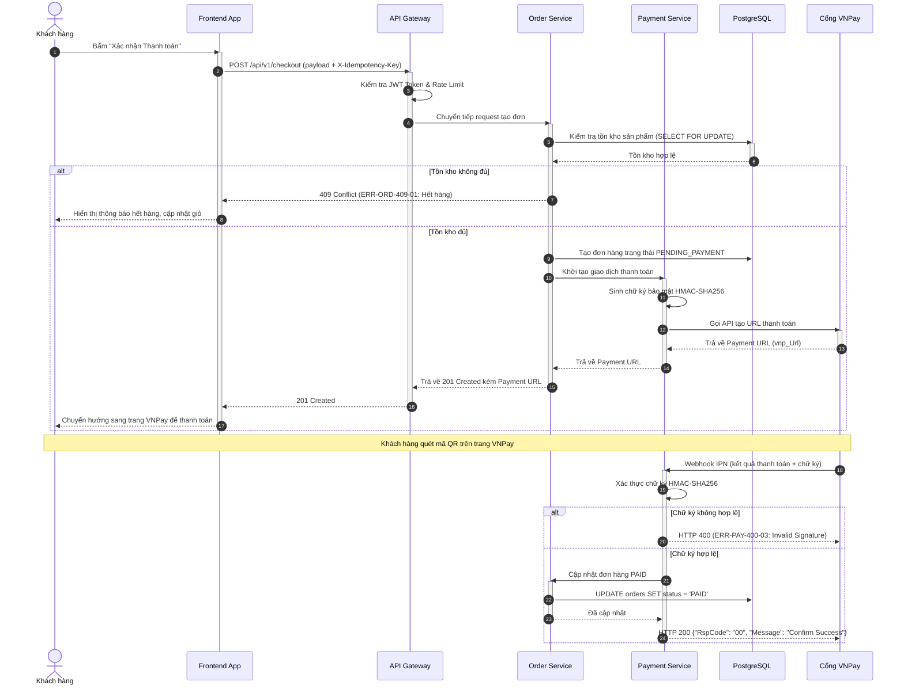

# Sơ đồ Tuần tự Tương tác Hệ thống (Sequence Diagram)

---
id: DIAG-SEQ-[FEATURE]-001
title: Sequence Diagram - [Tên Luồng Tương Tác]
version: 1.0.0
phase: 03-diagrams
domain: [Phân Hệ]
tags: [sequence, mermaid, interaction, api-flow]
author: [Tên Tác Giả]
last_updated: [YYYY-MM-DD]
---

## 1. Mô tả Bối cảnh Luồng (Scenario Context)
- **Tên luồng**: [vd: Quy trình Đặt hàng và Thanh toán qua Cổng VNPay]
- **Yêu cầu FR liên quan**: `FR-ORD-CHKT-001`, `FR-PAY-GATE-001`
- **Các bên tham gia (Participants)**:
  - `User`: Khách hàng sử dụng trình duyệt web hoặc mobile app.
  - `ClientApp`: Giao diện Web Frontend (Next.js) / Mobile App.
  - `APIGateway`: Cổng định tuyến API và kiểm tra JWT Token.
  - `OrderService`: Dịch vụ xử lý đơn hàng và tính toán giá trị.
  - `PaymentService`: Dịch vụ điều phối thanh toán và sinh chữ ký HMAC.
  - `VNPayGateway`: Cổng thanh toán đối tác bên ngoài.
  - `Database`: Cơ sở dữ liệu chính (PostgreSQL).

## 2. Sơ đồ Tuần tự Mermaid (Mermaid Sequence Diagram)

## 3. Bảng Giải thích Chi tiết Từng Bước Tương tác
| Bước | Bên gửi | Bên nhận | Phương thức / Hành động | Ý nghĩa nghiệp vụ |
| :---: | :--- | :--- | :--- | :--- |
| 1 | Khách hàng | Frontend App | Bấm Xác nhận | Bắt đầu quy trình checkout |
| 2 | Frontend | API Gateway | `POST /api/v1/checkout` | Gửi payload kèm Idempotency Key chống trùng |
| 5 | Order Service | Database | `SELECT FOR UPDATE` | Khóa dòng sản phẩm để tránh Race Condition |
| 10 | Order Service | Payment Service| Init Payment | Yêu cầu sinh link thanh toán |
| 17 | VNPay Gateway | Payment Service| Webhook IPN | Nhận kết quả thanh toán bất đồng bộ |
