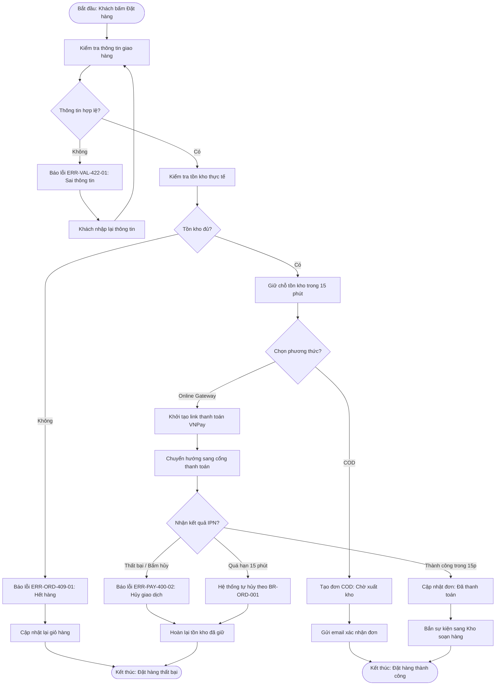

# Sơ đồ Hoạt động Nghiệp vụ (Activity Diagram)

---
id: DIAG-ACT-[FEATURE]-001
title: Activity Diagram - [Tên Quy Trình]
version: 1.0.0
phase: 03-diagrams
domain: [Phân Hệ]
tags: [activity, flowchart, mermaid, business-process]
author: [Tên Tác Giả]
last_updated: [YYYY-MM-DD]
---

## 1. Mô tả Quy trình Nghiệp vụ
Sơ đồ hoạt động mô hình hóa dòng chảy xử lý logic từ lúc bắt đầu cho đến khi hoàn thành, làm rõ các điểm rẽ nhánh điều kiện và các kịch bản ngoại lệ.

## 2. Sơ đồ Hoạt động Mermaid (Flowchart)

## 3. Danh mục Điểm Rẽ nhánh (Decision Gates)
- **Điểm 1 (Thông tin hợp lệ?)**: Kiểm tra định dạng số điện thoại, địa chỉ nhận hàng.
- **Điểm 2 (Tồn kho đủ?)**: Kiểm tra số lượng tồn khả dụng trong bảng kho.
- **Điểm 3 (Phương thức?)**: Phân luồng giữa COD (Thanh toán khi nhận) và Online (Cổng điện tử).
- **Điểm 4 (Kết quả IPN?)**: Đón nhận 3 khả năng: Thành công, Thất bại do hủy, hoặc Quá hạn 15 phút.
