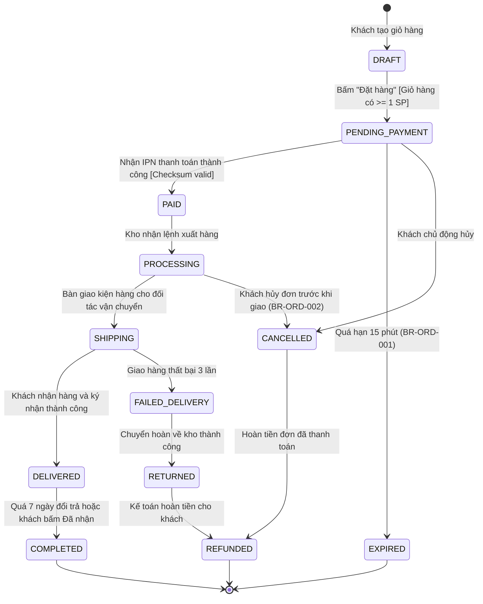

# Sơ đồ và Ma trận Trạng thái Thực thể (State Machine & Matrix)

---
id: DIAG-STA-[ENTITY]-001
title: State Machine Specification - [Tên Thực Thể - vd: Đơn Hàng]
version: 1.0.0
phase: 03-diagrams
domain: [Phân Hệ]
tags: [state-machine, fsm, mermaid, lifecycle]
author: [Tên Tác Giả]
last_updated: [YYYY-MM-DD]
---

## 1. Vòng đời Thực thể (Entity Lifecycle Overview)
Mô hình hóa toàn bộ vòng đời của thực thể `Order` từ khi khởi tạo đến các trạng thái kết thúc (Terminal States), đảm bảo không xảy ra hiện tượng chuyển dịch trạng thái bất hợp lệ.

## 2. Sơ đồ Trạng thái Mermaid (stateDiagram-v2)

## 3. Ma trận Chuyển dịch Trạng thái Chi tiết (State Transition Matrix)

| Trạng thái Hiện tại | Sự kiện Kích hoạt (Event) | Điều kiện Bảo vệ (Guard) | Trạng thái Tiếp theo | Tác nhân Thực hiện | Mã lỗi nếu Vi phạm |
| :--- | :--- | :--- | :--- | :--- | :--- |
| `DRAFT` | Bấm Đặt hàng | Giỏ hàng có >= 1 sản phẩm | `PENDING_PAYMENT` | Khách hàng | `ERR-ORD-422-01` |
| `PENDING_PAYMENT` | Nhận IPN thành công | Chữ ký HMAC đúng | `PAID` | Cổng thanh toán | `ERR-PAY-400-03` |
| `PENDING_PAYMENT` | Quá hạn thanh toán | `now() > expires_at` | `EXPIRED` (Terminal) | System Cron | - |
| `PAID` | Xuất kho | Tồn kho thực tế đủ | `PROCESSING` | Nhân viên kho | `ERR-WMS-409-02` |
| `PROCESSING` | Bàn giao đơn vị VC | Có mã vận đơn hợp lệ | `SHIPPING` | Nhân viên kho | `ERR-SHIP-422-01`|
| `SHIPPING` | Giao thành công | OTP xác nhận giao hàng | `DELIVERED` | Shipper | `ERR-SHIP-401-02`|
| `DELIVERED` | Hết hạn khiếu nại | `now() > delivered + 7d`| `COMPLETED` (Terminal) | System Cron | - |
| `PAID` | Khách yêu cầu hủy | Chưa chuyển sang `SHIPPING` | `CANCELLED` | Khách hàng / CSKH | `ERR-ORD-403-05` |
