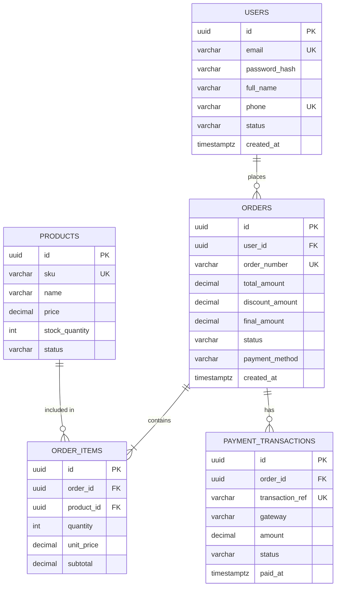

# Sơ đồ Quan hệ Thực thể (Entity Relationship Diagram - ERD)

---
id: DIAG-ERD-[MODULE]-001
title: Entity Relationship Diagram - [Tên Phân Hệ]
version: 1.0.0
phase: 03-diagrams
domain: [Cơ Sở Dữ Liệu]
tags: [erd, database, mermaid, data-modeling]
author: [Tên Tác Giả]
last_updated: [YYYY-MM-DD]
---

## 1. Mô tả Phạm vi Mô hình Dữ liệu
Sơ đồ ERD mô hình hóa các thực thể lưu trữ dữ liệu chính của phân hệ Đơn hàng & Thanh toán, tuân thủ chuẩn hóa 3NF và phân rã triệt để quan hệ nhiều-nhiều qua bảng trung gian.

## 2. Sơ đồ ERD Mermaid (`erDiagram`)

## 3. Bảng Từ điển Dữ liệu Tóm lược (Data Dictionary)
| Bảng | Cột | Kiểu | Nullable | Ràng buộc | Ý nghĩa |
| :--- | :--- | :---: | :---: | :--- | :--- |
| `orders` | `id` | UUID | No | Primary Key | Khóa chính đơn hàng |
| `orders` | `user_id` | UUID | No | Foreign Key `users.id` | Người đặt hàng |
| `orders` | `order_number` | VARCHAR(20) | No | Unique | Mã hiển thị tra cứu |
| `orders` | `final_amount` | DECIMAL(15,2)| No | `>= 0` | Số tiền thực trả sau giảm |
| `orders` | `status` | VARCHAR(50) | No | Default `'DRAFT'` | Trạng thái vòng đời FSM |
