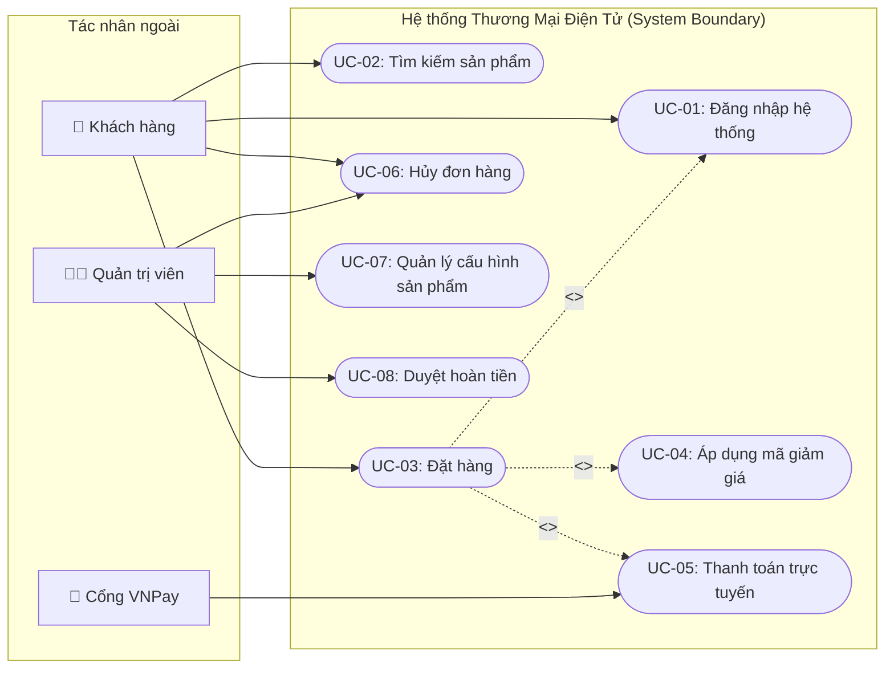

# Sơ đồ Ca sử dụng & Ranh giới Hệ thống (Use Case Diagram)

---
id: DIAG-UC-[MODULE]-001
title: Use Case Diagram - [Tên Phân Hệ]
version: 1.0.0
phase: 03-diagrams
domain: [Phân Hệ]
tags: [usecase-diagram, mermaid, system-boundary, actors]
author: [Tên Tác Giả]
last_updated: [YYYY-MM-DD]
---

## 1. Ranh giới Hệ thống & Tác nhân (Actors)
- **Tác nhân chính (Primary Actor)**: Khách hàng mua sắm (Guest & Registered User).
- **Tác nhân hỗ trợ (Secondary Actor)**: Nhân viên CSKH, Thủ kho, Quản trị viên.
- **Tác nhân hệ thống (System Actor)**: Cổng thanh toán VNPay, SMS Brandname Service.

## 2. Sơ đồ Use Case Mermaid

## 3. Bảng Danh mục Ca sử dụng Tóm tắt
| Mã UC | Tên Ca sử dụng | Tác nhân chính | Quan hệ phụ thuộc | Ghi chú |
| :--- | :--- | :--- | :--- | :--- |
| `UC-01` | Đăng nhập hệ thống | Khách hàng | - | Tiền đề để lưu thông tin giỏ hàng |
| `UC-03` | Đặt hàng | Khách hàng | `<<include>>` UC-01, UC-05 | Luồng nghiệp vụ cốt lõi |
| `UC-04` | Áp dụng mã giảm giá | Khách hàng | `<<extend>>` UC-03 | Chỉ kích hoạt khi khách có voucher |
| `UC-05` | Thanh toán trực tuyến | Khách hàng, VNPay | - | Phối hợp với cổng thanh toán |
