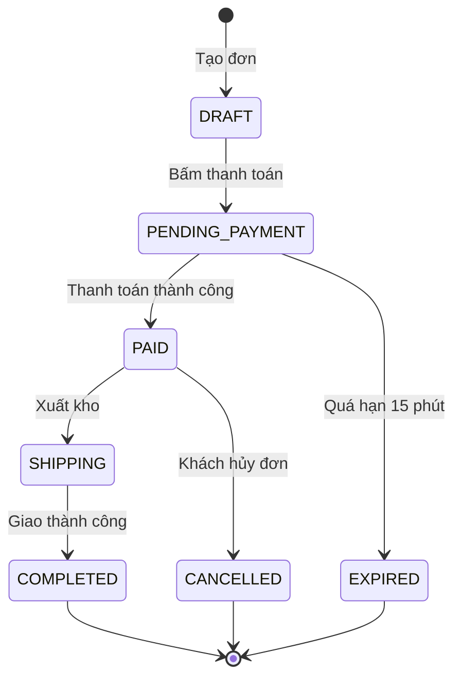

# Quy tắc Thiết kế Máy Trạng thái Hữu hạn (Finite State Machine - FSM)

## 1. Các thành phần bắt buộc
- **Trạng thái ban đầu (Initial State)**: Điểm bắt đầu của vòng đời đối tượng (`[*] --> INITIAL`).
- **Trạng thái kết thúc (Terminal / Final States)**: Các trạng thái kết thúc không thể chuyển tiếp (`COMPLETED`, `CANCELLED`, `REFUNDED` `--> [*]`).
- **Sự kiện kích hoạt (Event / Trigger)**: Hành động từ người dùng, webhook đối tác hoặc cron job hệ thống.
- **Điều kiện bảo vệ (Guard Condition)**: Ràng buộc logic kiểm tra (vd: `[số dư >= tổng tiền]`) trước khi cho phép chuyển trạng thái.
- **Quy tắc bất biến**: Tuyệt đối không có đường chuyển trạng thái đi ra khỏi Trạng thái kết thúc (Terminal State).

## 2. Ma trận chuyển dịch trạng thái chuẩn

| Trạng thái hiện tại | Sự kiện kích hoạt (Event) | Điều kiện kiểm tra (Guard) | Trạng thái tiếp theo | Actor / Hệ thống thực hiện | Mã lỗi nếu thất bại |
| :--- | :--- | :--- | :--- | :--- | :--- |
| `DRAFT` | Bấm gửi đơn | Giỏ hàng có >= 1 sản phẩm | `PENDING_PAYMENT` | Khách hàng | `ERR-ORD-422-01` |
| `PENDING_PAYMENT` | Nhận IPN thanh toán thành công | Chữ ký checksum hợp lệ | `PAID` | Cổng thanh toán (Webhook) | `ERR-PAY-400-03` |
| `PENDING_PAYMENT` | Hết hạn thanh toán (15 phút) | `now() > expires_at` | `EXPIRED` (Terminal) | System Cron | - |
| `PAID` | Kho xác nhận xuất hàng | Tồn kho thực tế đủ | `SHIPPING` | Nhân viên kho | `ERR-WMS-409-02` |
| `SHIPPING` | Khách xác nhận đã nhận hàng | OTP giao hàng hợp lệ | `COMPLETED` (Terminal) | Khách hàng / Shipper | `ERR-DLV-422-01` |
| `PAID` | Khách yêu cầu hủy đơn | Trạng thái chưa qua `SHIPPING` | `CANCELLED` (Terminal) | Khách hàng / Admin | `ERR-ORD-403-05` |

## 3. Cú pháp sơ đồ Mermaid chuẩn

